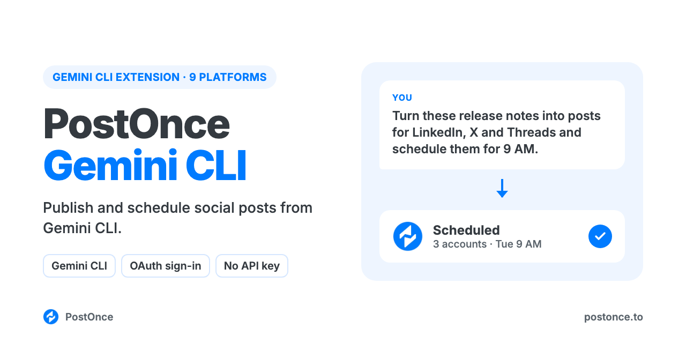

<p align="center"></p>

# PostOnce for Gemini CLI

The official [PostOnce](https://postonce.to) extension for Gemini CLI. Ask Gemini to write a post and it publishes or schedules it on LinkedIn, Instagram, TikTok, YouTube, X, Threads, Bluesky, Facebook and Pinterest, with a native version for each account, all through each platform's official API. There's no scraping, no browser automation and no developer apps to set up.

```
You:    Turn these release notes into posts for LinkedIn, X and Threads and
        schedule them for tomorrow at 9am.
Gemini: Wrote a version for each account: a LinkedIn post that ends on a
        question, a 240-character X post and a Threads post. Scheduled for
        Tue 9:00 AM on 3 accounts.
```

## Install

```bash
gemini extensions install https://github.com/postoncehq/postonce-gemini-extension
```

Start Gemini CLI and run `/mcp auth postonce`. Your browser opens PostOnce's sign-in; approve access and the PostOnce tools appear in `/mcp`. You don't need an API key.

You need a PostOnce account with your social accounts connected. You can [try it free for 7 days](https://postonce.to) without entering a card.

## What you can do

| Ask Gemini to | How it works |
| --- | --- |
| Post the same idea everywhere, written for each platform | One `create_post` with a `content_override` per account |
| Schedule posts for later | `create_post` with `publish_at`; drafts with `create_draft` |
| Publish images, carousels and video | `create_upload_url`, upload, then pass the media URLs |
| Crosspost every future post automatically | `create_workflow`: for example, each new Instagram Reel also goes to TikTok and YouTube Shorts |
| Check what went out, per platform | `get_post` returns each destination's status and URL |
| Change or cancel a scheduled post | `update_post`, `cancel_post` |

Platforms: LinkedIn (profiles and company pages), X, Threads, Bluesky, Facebook Pages, Instagram (Business or Creator), TikTok, YouTube and Pinterest. Not supported: Stories, reply chains and polls, first comments, analytics, reading comments, and editing posts that are already live.

`GEMINI.md` gives Gemini the same posting rules as the [PostOnce skill](https://github.com/postoncehq/postonce-skills): pick accounts by ID, respect each platform's limits and media rules, and ask only when an account, time or setting is genuinely unclear.

## Data and privacy

Gemini connects to `https://postonce.to/mcp` with OAuth and only reaches the accounts you connected in PostOnce. Revoke access any time in PostOnce under Preferences > AI agents > Connected apps. See the [privacy policy](https://postonce.to/privacy-policy).

## More

- [PostOnce Skills](https://github.com/postoncehq/postonce-skills) for Claude, ChatGPT, Cursor and Codex
- [MCP setup for every client](https://postonce.to/integrations/mcp)
- Support: support@postonce.to

MIT licensed.
